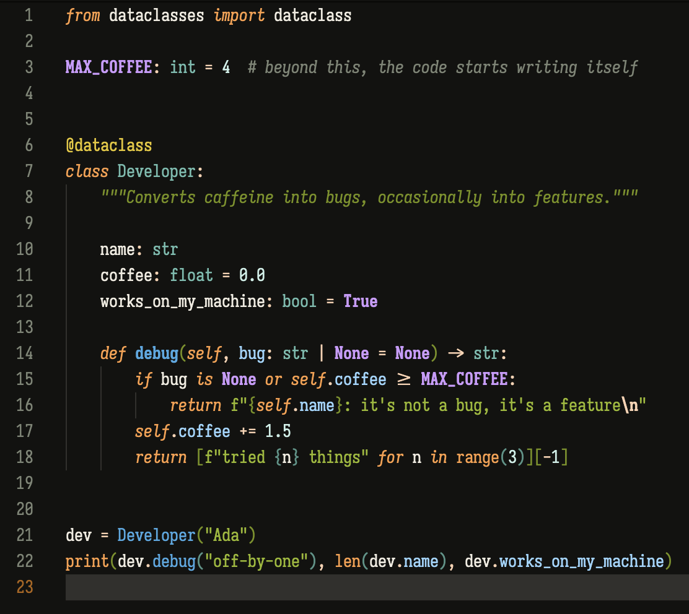

# Ayu Dark EMC

A warm, low-glare Ayu dark theme with an OKLCH-balanced palette, for Emacs and VS Code.

- [`themes/emacs/`](themes/emacs/) — the Emacs theme, `ayu-dark-emc-theme.el`. It is the single source of truth for the palette.
- [`vscode/`](vscode/) — the VS Code port, generated from the Emacs palette and published as [Ayu Dark EMC](https://marketplace.visualstudio.com/items?itemName=jerryemc.ayu-dark-emc).

## License

MIT
