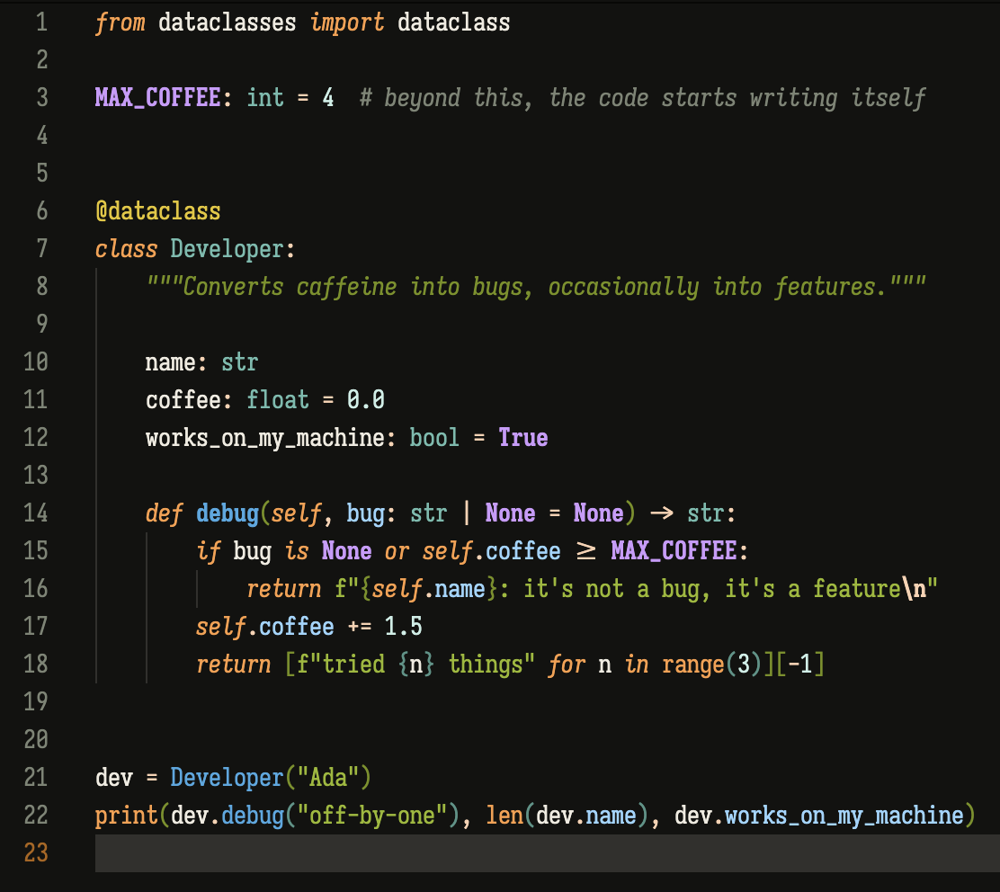

# Ayu Dark EMC

A warm, low-glare take on Ayu Dark for VS Code, ported from the `ayu-dark-emc` Emacs theme.

Every color family keeps a single OKLCH hue and shares the same lightness/chroma ladder (white, bright, light, medium, dark, grey, black), with per-family lightness offsets so yellow and blue read equally bright. Chroma is capped below the sRGB gamut edge, so nothing glows neon on the near-black `#121210` background.



## Syntax roles

| Role | Color | Style |
| --- | --- | --- |
| Keywords, storage, `self` / `this` | light orange `#FD9D44` | italic |
| Builtins (`print`, `len`, `console`) | light orange `#FD9D44` | |
| Function definitions | medium blue `#43A9E3` | bold |
| Function calls | medium blue `#43A9E3` | |
| Variable / parameter definitions, properties | bright blue `#97D5FE` | |
| Variable uses | default white `#EFEBE0` | |
| Types, classes | medium cyan `#19B3AD` | |
| Constants, `true` / `None` | light purple `#CE9AFD` | bold |
| Strings | medium lime `#98B91F` | |
| Docstrings / doc comments | dark lime `#779110` | italic |
| Numbers | white cyan `#A0EBE6` | |
| Operators, punctuation, escapes | white orange `#FCD1B0` | |
| Decorators, macros, preprocessor | light yellow `#E6C61D` | |
| Comments | default grey `#7C8474` | italic |

Brackets use the rainbow-delimiters ladder (dark lime, cyan, blue, purple, orange, yellow). The UI follows the Emacs mode-line, corfu, vertico, diff-hl and treemacs faces.

## Install

Search for **Ayu Dark EMC** in the Extensions view, or run:

```sh
code --install-extension jerryemc.ayu-dark-emc
```

Then pick it with **Preferences: Color Theme** (`Cmd+K Cmd+T`).

## License

MIT
